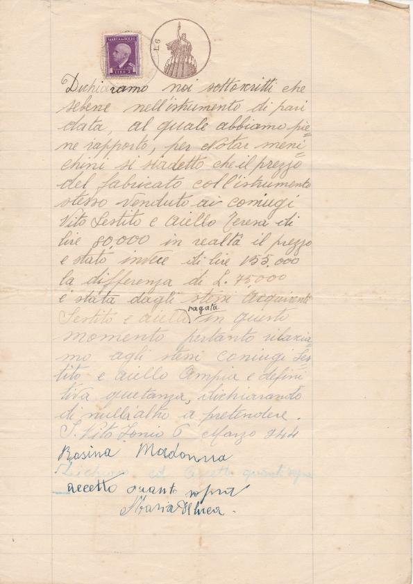

Dichiariamo noi sottoscritti che sebbene nell’istrumento di pari data, al quale abbiamo pieno rapporto, per Notaio Menichini si sia detto che il prezzo del fabbricato coll’instrumento stesso venduto ai coniugi Vito Sestito e Aiello Teresa di lire 80.000 in realtà il prezzo e stato invece di lire 155.000 la differenza di L. 75.000 è stata dagli stessi acquirenti Sestito e Aiello pagata in questo momento pertanto rilasciamo agli stessi coniugi Sestito e Aiello ampia e definitiva quietanza, dichiarando di null’altro a pretendere.

San Vito sullo Ionio 6 marzo 1944
