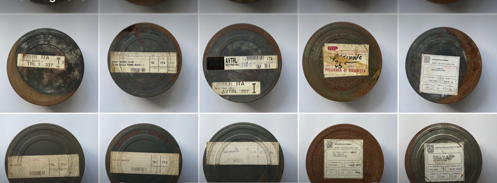

## Introduzione

Tra i materiali tecnici conservati nell’archivio, le **bobine dei trailer cinematografici** rappresentano una testimonianza di grande valore storico e materiale. Si tratta di piccoli rulli in pellicola **35mm**, inviati periodicamente dalle **case di distribuzione** ai cinema italiani per la promozione dei film in uscita.

Le bobine, generalmente lunghe pochi metri, contenevano una selezione di sequenze montate ad hoc per stimolare l’interesse del pubblico. Erano proiettate **prima della proiezione principale**, in genere assieme ai cinegiornali o ad altri annunci pubblicitari locali.

## Funzione e contesto d’uso

I trailer arrivavano a noleggio insieme ai film e passavano da un cinema all’altro tramite corriere. Le bobine conservate al Cinema Sestito, trovate accanto al proiettore, sono probabilmente quelle che non fu necessario restituire. Risalgono per lo più al periodo 1993–2003.

## Descrizione delle bobine

Le bobine si presentano in **contenitori metallici o di plastica**, ciascuno recante un’etichetta originale con le seguenti informazioni:

- titolo del film;  
- casa di distribuzione;  
- numero identificativo di copia;  
- eventuali note logistiche (es. “Trailer 1° parte”, “Versione italiana”, “Colore”).  

Le etichette, spesso scritte a macchina o con timbro tipografico, costituiscono un importante documento in sé, utile a ricostruire le **reti distributive** e le pratiche amministrative del settore.


