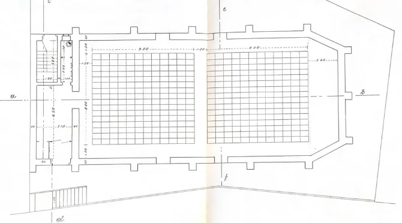

Il periodo compreso tra il 1957 e il 1979 rappresenta per il *Cinema Sestito* la fase di massimo splendore e, al tempo stesso, l’inizio di un lento declino. Dopo gli anni pionieristici della fondazione[^1], il cinema di San Vito sullo Ionio divenne un punto di riferimento culturale e sociale per l’intera area limitrofa, accogliendo un numero crescente di spettatori e consolidando la propria funzione di luogo d’incontro e di modernità.

I dati provenienti dal registro delle proiezioni mostrano un periodo costante del numero di film proposti fino al 1966, anno che segna l’apice dell’attività. A partire dalla fine degli anni Settanta, tuttavia, la curva inizia a scendere, riflettendo i mutamenti del mercato, la diffusione della televisione e l’emergere di nuove forme di intrattenimento. Nel 1979 il calo diventa significativo, aprendo una fase di progressivo ridimensionamento dell’offerta.

}}index_files/figure-html/unnamed-chunk-1-1.png" width="768" />

## La costruzione del nuovo cinema in Via Doria

Il successo crescente del cinema originale, situato in Piazza Mario Polerà, rese evidente la necessità di uno spazio più ampio. La sala non era più in grado di contenere il pubblico sempre più numeroso, e Vito Sestito decise di intraprendere un progetto ambizioso: costruire un nuovo cinema.

Nel 1955 acquistò da Giordano Rosa e dalla sorella Teresa un terreno in Via Doria per 1.150.000 lire[^2]. L’incarico della progettazione fu affidato all’ingegnere **Vincenzo Calzone** di Catanzaro[^3], che disegnò una struttura moderna, più capiente e rispondente alle esigenze di sicurezza e comfort dell’epoca.

I lavori iniziarono nel 1957 e si conclusero nel 1959. La costruzione del tetto fu un’impresa notevole: due squadre di operai si alternarono giorno e notte per completarlo in un’unica gettata di cemento, operazione necessaria per garantire la tenuta strutturale dell’edificio. L’impresa fu considerata un piccolo prodigio ingegneristico e simbolo della determinazione collettiva che accompagnò l’intera opera.

## Un progetto comunitario

Il nuovo cinema fu frutto di uno sforzo condiviso. Il sindaco **Ferdinando Migliaccio**, l’amministrazione comunale e parte della popolazione parteciparono, in forme diverse, alla realizzazione dell’edificio. L’iniziativa di Vito Sestito divenne così un progetto comunitario, espressione della volontà di riscatto e di modernizzazione di un paese che, nel secondo dopoguerra, cercava nuovi spazi per la vita culturale e sociale[^4].

Il **3 marzo 1959**, Vito Sestito firmò il contratto con la **Società Elettrica** per la fornitura della corrente, primo atto concreto che segnava la messa in funzione del nuovo edificio cinematografico[^5].  

Pochi giorni dopo si svolse il **collaudo statico** della struttura, sotto la supervisione dell’architetto **Zanini**. Per verificare la resistenza del pilastro centrale della sala vennero posizionate, tramite una gru, **tonnellate di sabbia e pietre**, con un sistema di misurazione volto a rilevare eventuali cedimenti. Il test, datato **26 aprile 1959**, fu superato con esito positivo, consentendo di procedere con le pratiche amministrative per l’apertura.

L’**autorizzazione ufficiale** del **Prefetto della Provincia di Catanzaro** giunse soltanto il **6 giugno 1959**, attestando la piena agibilità del locale e la conformità alle norme di sicurezza[^6]. Tuttavia, le testimonianze e i documenti di programmazione mostrano che il cinema aveva già **iniziato a operare informalmente** prima del completamento dell’iter: la prima proiezione nota, quella del film *Re vagabondo*, si tenne infatti il **24 aprile 1959**, cioè **due giorni prima del collaudo** e più di un mese prima dell’autorizzazione ufficiale[^7].

Questa discrepanza tra le date, comune nella prassi amministrativa dell’Italia di provincia del dopoguerra, suggerisce che l’apertura del cinema fosse stata anticipata per motivi celebrativi e comunitari, in un clima di entusiasmo collettivo che precedette la formalizzazione burocratica dell’attività.

## L’inaugurazione e l’inizio di una nuova era

La serata inaugurale del **24 aprile 1959**, con la proiezione gratuita di *Re vagabondo*, rappresentò un evento memorabile per l’intera cittadinanza. Il nuovo *Cinema Teatro Sestito* divenne immediatamente un **simbolo di progresso e di coesione sociale**, punto d’incontro per il paese e segno tangibile del rinnovamento culturale che stava attraversando San Vito sullo Ionio.

Il nuovo edificio disponeva di una **cabina di proiezione isolata** per ragioni di sicurezza: le bobine di pellicola, all’epoca in celluloide, erano altamente infiammabili, e le norme imponevano l’uso di estintori sempre funzionanti. La scala d’accesso alla cabina era posta all’esterno, separata dall’ingresso principale.  

Il **palco in legno**, accessibile tramite due scalette laterali, fu spesso utilizzato anche per rappresentazioni teatrali e saggi scolastici. Negli anni del liceo, **Stefano Sestito** ricorda che la preside **Santulli** volle riportare nel cinema lo spirito del teatro popolare, organizzandovi commedie e spettacoli studenteschi.

Oltre alla funzione cinematografica e teatrale, il nuovo cinema divenne anche un luogo di aggregazione sociale, utilizzato per **banchetti e ricevimenti di nozze**. Negli anni Sessanta e Settanta, quando non esistevano ancora sale dedicate o ristoranti abbastanza ampi, il cinema rappresentava **l’unico spazio al coperto capace di accogliere tutti gli invitati**. Dopo le cerimonie, le famiglie sanvitesi allestivano il ricevimento nella sala d'ingresso del cinema e le persone poi prendevano posto tra le sedie, gli sposi venivano messi sul palco del teatro, trasformando temporaneamente il luogo dello spettacolo in un ambiente conviviale. Questo uso multifunzionale sottolinea il ruolo del cinema come **cuore pulsante della vita comunitaria**, in cui si intrecciavano intrattenimento, socialità e celebrazioni private.

La galleria fotografica testimonia questa consuetudine, gli invitati posano davanti allo schermo bianco del cinema, si intravedono le sedie del cinema ai lati e il palco dietro, restituendo un’immagine vivida del modo in cui lo spazio cinematografico veniva reinterpretato come luogo di festa:



## L’espansione degli anni Sessanta

Durante gli anni Sessanta, il cinema consolidò la propria rete di rapporti con le principali case di distribuzione nazionali e internazionali. Nel **1966** furono stipulati numerosi contratti con società cinematografiche di rilievo:

- 16 febbraio 1966 — *Argos*  
- 22 gennaio 1966 — *Titanus*  
- 26 marzo 1966 — *Paramount Pictures*  
- 18 maggio 1966 — *Twentieth Century Fox*  
- 8 settembre 1966 — *Warner Bros.*

Questi accordi testimoniano la piena integrazione del cinema di San Vito nei circuiti nazionali della distribuzione cinematografica, permettendo al pubblico locale di accedere a produzioni italiane e internazionali di grande richiamo.

## Declino e trasformazione (1970–1979)

A partire dai primi anni Settanta, la situazione cominciò lentamente a cambiare. La diffusione della **televisione** e la trasformazione delle abitudini collettive ridussero l’affluenza nelle sale cinematografiche di paese. Anche il cinema di San Vito registrò una graduale diminuzione delle proiezioni annuali, fino a un calo significativo nel **1979**, che segnò la fine del periodo d’oro.

Il cinema, tuttavia, non cessò di rappresentare un punto di riferimento per la comunità, continuando a ospitare spettacoli teatrali, manifestazioni scolastiche e incontri pubblici. L’identità del luogo - tra cultura, memoria e socialità - rimase intatta, anche in un’epoca di trasformazioni e difficoltà economiche.

## Conclusione

Il ventennio 1957–1979 costituisce il cuore pulsante della storia del *Cinema Sestito*. In questi anni, la sala non solo raggiunse la sua massima espansione, ma divenne anche uno spazio simbolico di progresso e coesione sociale. La costruzione del nuovo edificio, il sostegno della cittadinanza e la qualità della programmazione proiettano l’esperienza di San Vito oltre i confini locali, rendendola parte integrante della più ampia storia del cinema popolare italiano del Novecento.

[^1]: La nascita del cinema a San Vito sullo Ionio. [Link all'articolo](/2023/04/27/la-nascita-del-cinema-a-san-vito/)
[^2]: *Acquisto terreni in Via Comm. Doria*, San Vito sullo Ionio, 1955. [Parte 1](/1955/12/26/acquisto-terreno-cinema-in-via-comm-doria/); [Parte 2](/1956/03/01/acquisto-terreno-cinema-in-via-comm-doria-parte-2/)
[^3]: *Progetto sala cinematografica*, Catanzaro, 1957. [Link al documento](/1957/01/01/1957-1959-progetto-sala-cinematografica-via-comm-doria/)
[^4]: Testimonianze orali raccolte dai figli e dai familiari di Vito Sestito
[^5]: Contratto con *Società Elettrica delle Calabrie*, Soverato,3 marzo 1959. [Link al documento](/1959/03/03/contratto-con-societ-elettrica-delle-calabrie/)
[^6]: Prefettura di Catanzaro, *Autorizzazione all’apertura del locale cinematografico*, 6 giugno 1959. [Link al documento](/1959/06/30/abilitazione-cinema-via-comm-doria/)
[^7]: Agenda *Bruzia 1958-59*, San Vito sullo Ionio, 1 febbraio 1959. [Link al documento](/1959/02/01/bruzia-1958-59/)
  

