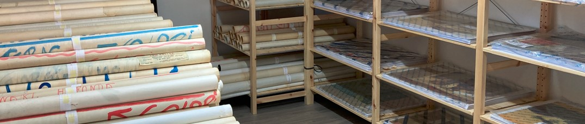

I **manifesti e le locandine** del cinema Sestito costituiscono la componente visiva dell'archivio documentario, restituendo l'immagine con cui ogni film si presentava al pubblico di San Vito sullo Ionio. Fotobuste, locandine e manifesti di grande formato, conservati nell'archivio della sala, accompagnano la programmazione ricostruita anno per anno e ne offrono un controcanto grafico, fatto di colori, caratteri tipografici e immaginario promozionale.

Osservati nel loro insieme, questi materiali permettono di seguire l'evoluzione del linguaggio pubblicitario cinematografico, la varietà dei formati impiegati e le scelte di comunicazione adottate dalla sala. Accanto ai pezzi di produzione ufficiale compaiono anche i manifesti realizzati a mano, utilizzati quando il materiale originale non era disponibile: testimonianze preziose di un artigianato locale che ha contribuito a dare un volto alla programmazione.

La sezione è articolata in più aree tematiche per facilitare la consultazione e l'esplorazione:

- 📅 **[Anni](/posters/by-year/)** - Manifesti e locandine organizzati cronologicamente per anno e mese di programmazione, a partire dalla data della proiezione in sala.
- 📐 **[Formati](/posters/by-size/)** - Suddivisione per dimensione: fotobuste 50x70, locandine 33x70 e manifesti 70x100, 100x140 e 140x200.
- 🎬 **[Generi](/posters/by-genre/)** - Il patrimonio grafico raccolto per genere cinematografico, per osservare come cambiano immagini e toni.
- 🔤 **[Titoli](/posters/by-title/)** - Elenco alfabetico dei film, per ritrovare rapidamente il manifesto di un titolo.
- ✏️ **[Retro](/posters/retro/)** - I manifesti dipinti e realizzati a mano, impiegati in assenza del materiale ufficiale.

Per conoscere la provenienza dei materiali, i criteri di catalogazione e i limiti dell'archivio, consulta la [nota metodologica](/2026/11/11/metodologia-ricostruzione-programmazione/).

---

Questa raccolta nasce dall'intento di preservare e rendere accessibile la memoria visiva di un cinema di provincia, dove l'immagine stampata o dipinta era il primo invito alla visione e parte integrante della vita quotidiana del paese.
