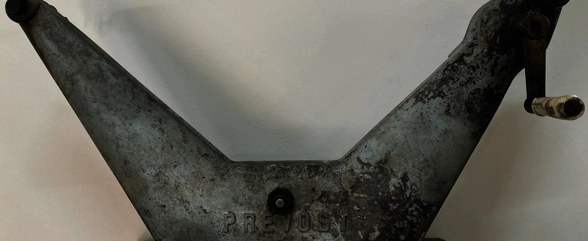

La **programmazione cinematografica** del cinema Sestito costituisce una delle componenti centrali dell’archivio documentario, offrendo una testimonianza diretta della vita culturale e sociale di San Vito sullo Ionio nel secondo dopoguerra. Attraverso l’analisi di fonti primarie - tra cui registri, appunti, e calendari - è stato possibile ricostruire, anno per anno, l’offerta filmica della sala e le sue trasformazioni nel tempo.

L’insieme dei dati raccolti consente di osservare l’evoluzione del gusto del pubblico locale, le strategie distributive adottate, e le modalità con cui il cinema ha risposto alle dinamiche economiche e culturali del territorio. La varietà dei titoli proposti, spesso non allineati ai circuiti mainstream, riflette una programmazione eterogenea e talvolta audace, che ha contribuito a definire l’identità della sala come spazio di visione non convenzionale.

La sezione è articolata in più aree tematiche per facilitare la consultazione e l’approfondimento:

- 📖 **[Fonti](/programmazione-storica/fonti/)** - Rassegna delle agende, rubriche, calendari e appunti originali utilizzati per la ricostruzione della programmazione.
- 📅 **[Anni](/programmazione-storica/anni/)** - Serie di pagine organizzate cronologicamente, che documentano i programmi cinematografici mese per mese dal 1948 al 2004.
- 🌍 **[Paesi di produzione](/programmazione-storica/paesi-di-produzione/)** - Pagine che mostrano la provenienza dei film.
- 🎬 **[Generi](/programmazione-storica/generi/)** - Suddivisione dei film per genere cinematografico, per seguire l’evoluzione dei gusti e delle tendenze.

Per conoscere le fonti, i criteri di identificazione dei film e i limiti dei dati, consulta la [metodologia di ricostruzione della programmazione](/2026/11/11/metodologia-ricostruzione-programmazione/).

---

Questa raccolta nasce dall’intento di restituire alla comunità e agli studiosi la memoria storica di un cinema di provincia, inteso come specchio delle pratiche culturali quotidiane e delle trasformazioni sociali della Calabria nel corso del Novecento.
