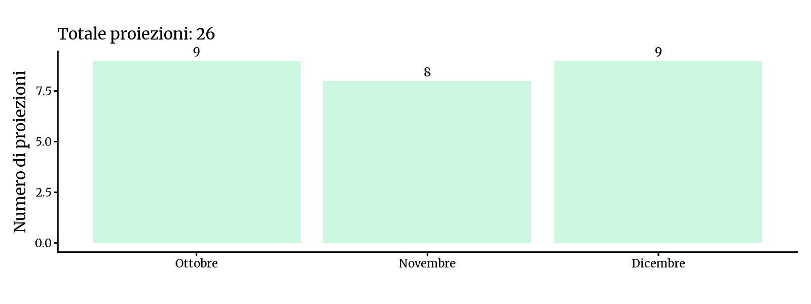
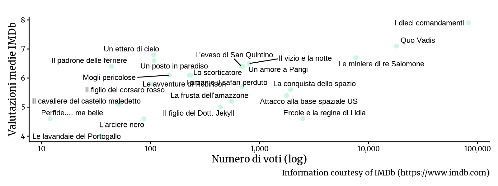

<!-- Generato da R/update-anni.R; modificare i dati, non questa pagina. -->

I grafici riassumono le voci di programmazione associate alle date nel database, non il numero delle singole proiezioni. In alcuni casi la data assegnata puo' essere adiacente a quella riportata nella fonte; per verificarla, consulta la scansione e la [metodologia](/2026/11/11/metodologia-ricostruzione-programmazione/).

I voti IMDb descrivono le valutazioni degli utenti IMDb, non il pubblico o gli incassi del Cinema Sestito.

> La documentazione disponibile per questo anno e' parziale: i mesi senza registrazioni non indicano necessariamente l'assenza di proiezioni.

### Ottobre[^1]

|           |                                       |
|:----------|:--------------------------------------|
| 1960-10-01 | [La congiura dei Borgia](https://www.imdb.com/title/tt0051487/) |
| 1960-10-08 | [I dieci comandamenti](https://www.imdb.com/title/tt0049833/) |
| 1960-10-13 | [Il figlio del Dott. Jekyll](https://www.imdb.com/title/tt0044061/) |
| 1960-10-16 | [Lo scorticatore](https://www.imdb.com/title/tt0052162/) |
| 1960-10-20 | [Un ettaro di cielo](https://www.imdb.com/title/tt0052789/) |
| 1960-10-23 | [Ercole e la regina di Lidia](https://www.imdb.com/title/tt0052782/) |
| 1960-10-24 | [Un amore a Parigi](https://www.imdb.com/title/tt0050721/) |
| 1960-10-25 | [L'evaso di San Quintino](https://www.imdb.com/title/tt0050526/) |
| 1960-10-30 | [Il figlio del corsaro rosso](https://www.imdb.com/title/tt0051616/) |

### Novembre

|           |                                       |
|:----------|:--------------------------------------|
| 1960-11-01 | [Un posto in paradiso](https://www.imdb.com/title/tt0052358/) |
| 1960-11-05 | [Il cavaliere del castello maledetto](https://www.imdb.com/title/tt0051463/) |
| 1960-11-08 | [Le avventure di Robinson](https://www.imdb.com/title/tt0050905/) |
| 1960-11-11 | [Il vizio e la notte](https://www.imdb.com/title/tt0051568/) |
| 1960-11-12 | [Tarzan e il safari perduto](https://www.imdb.com/title/tt0051057/) |
| 1960-11-19 | [Il padrone delle ferriere](https://www.imdb.com/title/tt0052042/) |
| 1960-11-26 | [Quo Vadis](https://www.imdb.com/title/tt0043949/) |
| 1960-11-29 | [La conquista dello spazio](https://www.imdb.com/title/tt0047947/) |

### Dicembre

|           |                                       |
|:----------|:--------------------------------------|
| 1960-12-01 | [Le lavandaie del Portogallo](https://www.imdb.com/title/tt0050626/) |
| 1960-12-02 | [La frusta dell'amazzone](https://www.imdb.com/title/tt0051438/) |
| 1960-12-04 | [L'arciere nero](https://www.imdb.com/title/tt0052574/) |
| 1960-12-08 | [Perfide.... ma belle](https://www.imdb.com/title/tt0053161/) |
| 1960-12-09 | [Attacco alla base spaziale US](https://www.imdb.com/title/tt0047033/) |
| 1960-12-10 | [Le miniere di re Salomone](https://www.imdb.com/title/tt0042646/) |
| 1960-12-12 | [Mogli pericolose](https://www.imdb.com/title/tt0051941/) |
| 1960-12-12 | [Le insaziabili](https://www.imdb.com/title/tt0051780/) |
| 1960-12-15 | [Sergente d'ispezione](https://www.imdb.com/title/tt0052184/) |

[^1]: Fonti: [Fedi 1960-61]()

