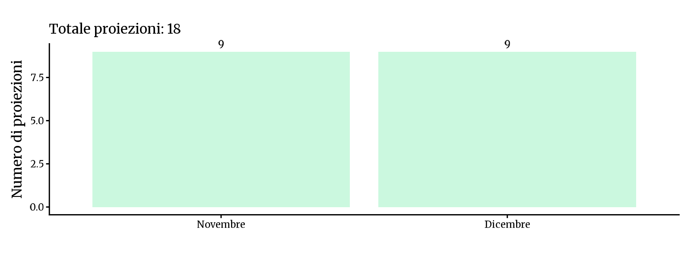
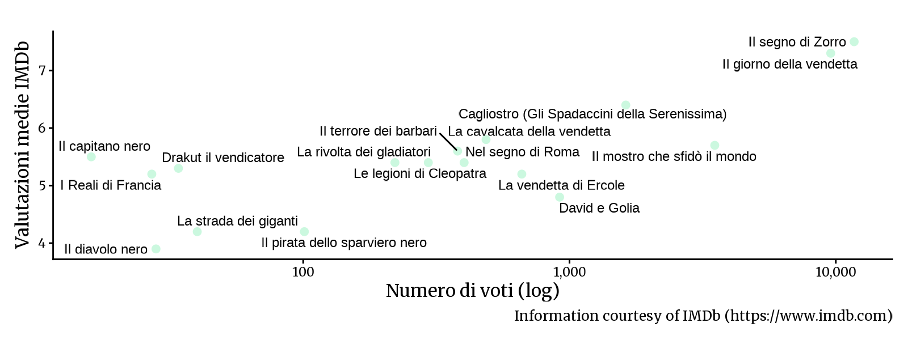

<!-- Generato da R/update-anni.R; modificare i dati, non questa pagina. -->

I grafici riassumono le voci di programmazione associate alle date nel database, non il numero delle singole proiezioni. In alcuni casi la data assegnata puo' essere adiacente a quella riportata nella fonte; per verificarla, consulta la scansione e la [metodologia](/2026/11/11/metodologia-ricostruzione-programmazione/).

I voti IMDb descrivono le valutazioni degli utenti IMDb, non il pubblico o gli incassi del Cinema Sestito.

> La documentazione disponibile per questo anno e' parziale: i mesi senza registrazioni non indicano necessariamente l'assenza di proiezioni.

### Novembre[^1]

|           |                                       |
|:----------|:--------------------------------------|
| 1961-11-04 | [Le legioni di Cleopatra](https://www.imdb.com/title/tt0052999/) |
| 1961-11-07 | [Il diavolo nero](https://www.imdb.com/title/tt0050313/) |
| 1961-11-12 | [La vendetta di Ercole](https://www.imdb.com/title/tt0054437/) |
| 1961-11-15 | [Cagliostro (Gli Spadaccini della Serenissima)](https://www.imdb.com/title/tt0041182/) |
| 1961-11-19 | [La strada dei giganti](https://www.imdb.com/title/tt0054344/) |
| 1961-11-22 | [Il segno di Zorro](https://www.imdb.com/title/tt0032762/) |
| 1961-11-26 | [David e Golia](https://www.imdb.com/title/tt0054788/) |
| 1961-11-28 | [La cavalcata della vendetta](https://www.imdb.com/title/tt0050900/) |
| 1961-11-30 | [Il mostro che sfidò il mondo](https://www.imdb.com/title/tt0050722/) |

### Dicembre

|           |                                       |
|:----------|:--------------------------------------|
| 1961-12-02 | [Il terrore dei barbari](https://www.imdb.com/title/tt0053346/) |
| 1961-12-05 | [Mantelli e spade insanguinate](https://www.imdb.com/title/tt0198713/) |
| 1961-12-09 | [Il pirata dello sparviero nero](https://www.imdb.com/title/tt0052072/) |
| 1961-12-10 | [I Reali di Francia](https://www.imdb.com/title/tt0053210/) |
| 1961-12-13 | [Il capitano nero](https://www.imdb.com/title/tt0042307/) |
| 1961-12-13 | [La rivolta dei gladiatori](https://www.imdb.com/title/tt0052123/) |
| 1961-12-16 | [Il giorno della vendetta](https://www.imdb.com/title/tt0052993/) |
| 1961-12-18 | [Drakut il vendicatore](https://www.imdb.com/title/tt0054239/) |
| 1961-12-19 | [Nel segno di Roma](https://www.imdb.com/title/tt0051985/) |

[^1]: Fonti: [Fedi 1961-62]()

