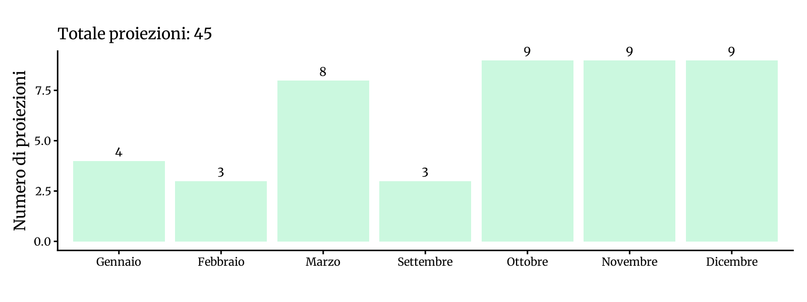
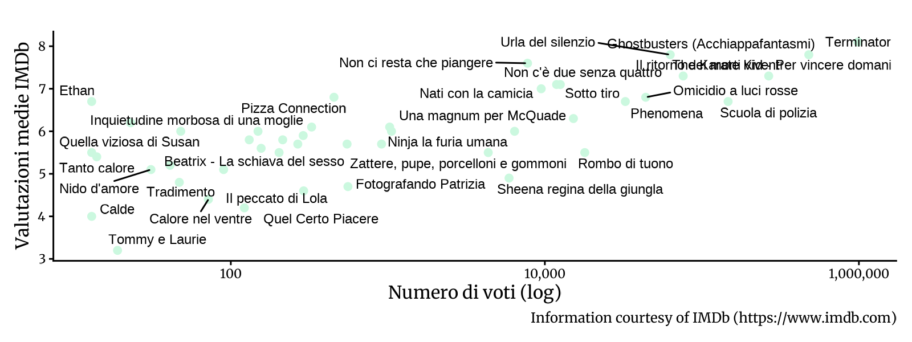

<!-- Generato da R/update-anni.R; modificare i dati, non questa pagina. -->

I grafici riassumono le voci di programmazione associate alle date nel database, non il numero delle singole proiezioni. In alcuni casi la data assegnata puo' essere adiacente a quella riportata nella fonte; per verificarla, consulta la scansione e la [metodologia](/2026/11/11/metodologia-ricostruzione-programmazione/).

I voti IMDb descrivono le valutazioni degli utenti IMDb, non il pubblico o gli incassi del Cinema Sestito.

### Gennaio[^1]

|           |                                       |
|:----------|:--------------------------------------|
| 1985-01-06 | [Tanto calore](https://www.imdb.com/title/tt0210323/) |
| 1985-01-13 | [Quel Certo Piacere](https://www.imdb.com/title/tt0218172/) |
| 1985-01-22 | [Bruce Lee l'immortale campione](https://www.imdb.com/title/tt0165741/) |
| 1985-01-27 | [Tommy e Laurie](https://www.imdb.com/title/tt0197022/) |

### Febbraio

|           |                                       |
|:----------|:--------------------------------------|
| 1985-02-03 | [Inquietudine morbosa di una moglie](https://www.imdb.com/title/tt1407301/) |
| 1985-02-17 | [Calore nel ventre](https://www.imdb.com/title/tt0288704/) |
| 1985-02-23 | [Mantidi in amore](https://www.imdb.com/title/tt0078821/) |

### Marzo

|           |                                       |
|:----------|:--------------------------------------|
| 1985-03-09 | [Bruce Lee: l'ira del drago colpisce anche l'Occidente](https://www.imdb.com/title/tt0165117/) |
| 1985-03-10 | [Beatrix - La schiava del sesso](https://www.imdb.com/title/tt0202818/) |
| 1985-03-16 | [Voglie erotiche di una porno pizzaiola (Hot &amp; Saucy Pizza Girls)](https://www.imdb.com/title/tt0127113/) |
| 1985-03-17 | [Fotografando Patrizia](https://www.imdb.com/title/tt0089163/) |
| 1985-03-24 | [Ninja la furia umana](https://www.imdb.com/title/tt0086192/) |
| 1985-03-28 | [Guerre stradali](https://www.imdb.com/title/tt0084616/) |
| 1985-03-29 | [Nati con la camicia](https://www.imdb.com/title/tt0085601/) |
| 1985-03-31 | [Bruce Lee terrore d'oriente](https://www.imdb.com/title/tt0201175/) |

### Settembre

|           |                                       |
|:----------|:--------------------------------------|
| 1985-09-15 | [Il peccato di Lola](https://www.imdb.com/title/tt0089790/) |
| 1985-09-21 | [Il ritorno dei morti viventi](https://www.imdb.com/title/tt0089907/) |
| 1985-09-24 | [Non c'è due senza quattro](https://www.imdb.com/title/tt0087481/) |

### Ottobre

|           |                                       |
|:----------|:--------------------------------------|
| 1985-10-06 | [Sheena regina della giungla](https://www.imdb.com/title/tt0088103/) |
| 1985-10-07 | [Rombo di tuono](https://www.imdb.com/title/tt0087727/) |
| 1985-10-13 | [Nido d'amore](https://www.imdb.com/title/tt0212259/) |
| 1985-10-15 | [Pizza Connection](https://www.imdb.com/title/tt0089813/) |
| 1985-10-19 | [Una magnum per McQuade](https://www.imdb.com/title/tt0085862/) |
| 1985-10-22 | [I due carabinieri](https://www.imdb.com/title/tt0087181/) |
| 1985-10-26 | [Omicidio a luci rosse](https://www.imdb.com/title/tt0086984/) |
| 1985-10-27 | [Jhoanna farfalla in calore (Skin-Flicks)](https://www.imdb.com/title/tt0079913/) |
| 1985-10-29 | [Vacanze in America](https://www.imdb.com/title/tt0090247/) |

### Novembre

|           |                                       |
|:----------|:--------------------------------------|
| 1985-11-01 | [Sotto tiro](https://www.imdb.com/title/tt0086510/) |
| 1985-11-02 | [The Karate Kid - Per vincere domani](https://www.imdb.com/title/tt0087538/) |
| 1985-11-05 | [Cuori nella tormenta](https://www.imdb.com/title/tt0144155/) |
| 1985-11-11 | [Non ci resta che piangere](https://www.imdb.com/title/tt0087814/) |
| 1985-11-17 | [Quella viziosa di Susan](https://www.imdb.com/title/tt0206874/) |
| 1985-11-18 | [Terminator](https://www.imdb.com/title/tt0088247/) |
| 1985-11-21 | [Tradimento](https://www.imdb.com/title/tt0084812/) |
| 1985-11-23 | [Zattere, pupe, porcelloni e gommoni](https://www.imdb.com/title/tt0088333/) |
| 1985-11-25 | [Lui è peggio di me](https://www.imdb.com/title/tt0087653/) |

### Dicembre

|           |                                       |
|:----------|:--------------------------------------|
| 1985-12-05 | [Phenomena](https://www.imdb.com/title/tt0087909/) |
| 1985-12-06 | [Scuola di polizia](https://www.imdb.com/title/tt0087928/) |
| 1985-12-08 | [Ethan](https://www.imdb.com/title/tt0303977/) |
| 1985-12-09 | [Ghostbusters (Acchiappafantasmi)](https://www.imdb.com/title/tt0087332/) |
| 1985-12-13 | [Bruce Lee l'invincibile del kung fu](https://www.imdb.com/title/tt0081216/) |
| 1985-12-26 | [Amarsi un po'...](https://www.imdb.com/title/tt0086881/) |
| 1985-12-27 | [Bruce Lee la tigre indomabile](https://www.imdb.com/title/tt0075167/) |
| 1985-12-29 | [Calde](https://www.imdb.com/title/tt4290202/) |
| 1985-12-30 | [Urla del silenzio](https://www.imdb.com/title/tt0087553/) |

[^1]: Fonti: [Calendario 1985](), [Calendario 1985\_2](), [CIF 1985-86](), [Rubrica 1984-92]()

