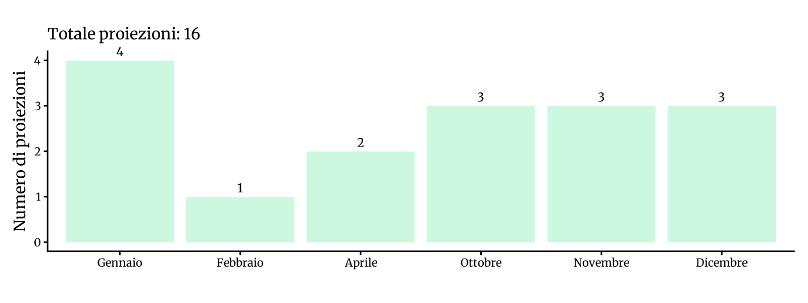
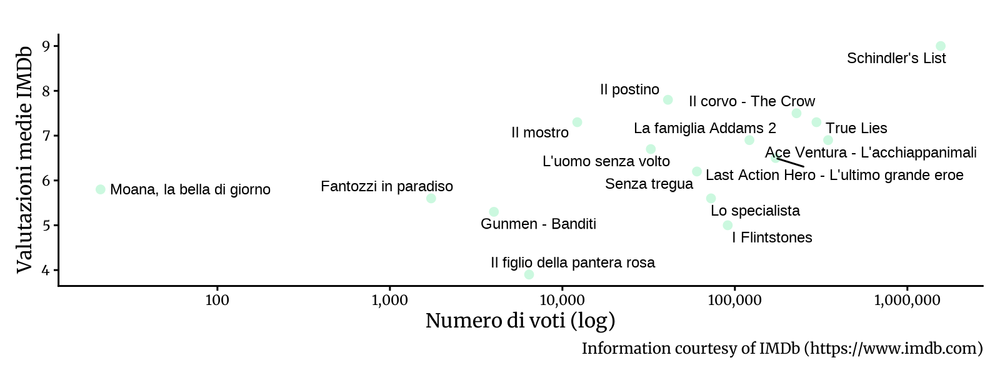

<!-- Generato da R/update-anni.R; modificare i dati, non questa pagina. -->

I grafici riassumono le voci di programmazione associate alle date nel database, non il numero delle singole proiezioni. In alcuni casi la data assegnata puo' essere adiacente a quella riportata nella fonte; per verificarla, consulta la scansione e la [metodologia](/2026/11/11/metodologia-ricostruzione-programmazione/).

I voti IMDb descrivono le valutazioni degli utenti IMDb, non il pubblico o gli incassi del Cinema Sestito.

### Gennaio[^1]

|           |                                       |
|:----------|:--------------------------------------|
| 1994-01-02 | [L'uomo senza volto](https://www.imdb.com/title/tt0107501/) |
| 1994-01-09 | [Last Action Hero - L'ultimo grande eroe](https://www.imdb.com/title/tt0107362/) |
| 1994-01-16 | [Gunmen - Banditi](https://www.imdb.com/title/tt0109959/) |
| 1994-01-23 | [Il figlio della pantera rosa](https://www.imdb.com/title/tt0108187/) |

### Febbraio

|           |                                       |
|:----------|:--------------------------------------|
| 1994-02-06 | [Fantozzi in paradiso](https://www.imdb.com/title/tt0106867/) |

### Aprile

|           |                                       |
|:----------|:--------------------------------------|
| 1994-04-01 | [La famiglia Addams 2](https://www.imdb.com/title/tt0106220/) |
| 1994-04-17 | [Senza tregua](https://www.imdb.com/title/tt0107076/) |

### Ottobre

|           |                                       |
|:----------|:--------------------------------------|
| 1994-10-16 | [Ace Ventura - L'acchiappanimali](https://www.imdb.com/title/tt0109040/) |
| 1994-10-16 | [Moana, la bella di giorno](https://www.imdb.com/title/tt0187307/) |
| 1994-10-30 | [Schindler's List](https://www.imdb.com/title/tt0108052/) |

### Novembre

|           |                                       |
|:----------|:--------------------------------------|
| 1994-11-06 | [Il postino](https://www.imdb.com/title/tt0110877/) |
| 1994-11-20 | [Il corvo - The Crow](https://www.imdb.com/title/tt0109506/) |
| 1994-11-27 | [I Flintstones](https://www.imdb.com/title/tt0109813/) |

### Dicembre

|           |                                       |
|:----------|:--------------------------------------|
| 1994-12-04 | [Il mostro](https://www.imdb.com/title/tt0110570/) |
| 1994-12-18 | [True Lies](https://www.imdb.com/title/tt0111503/) |
| 1994-12-25 | [Lo specialista](https://www.imdb.com/title/tt0111255/) |

[^1]: Fonti: [Calendario 1994](), [New Europe 1993-94](), [New Europe 1994-95]()

