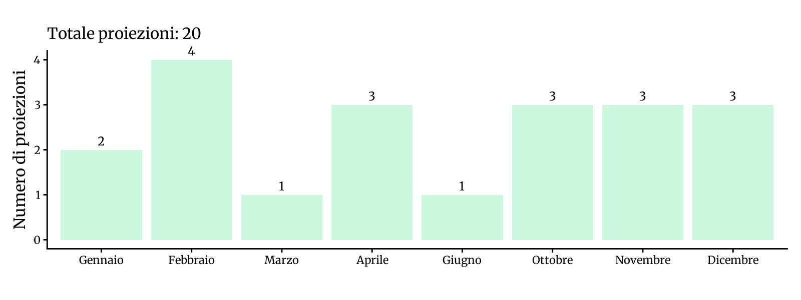
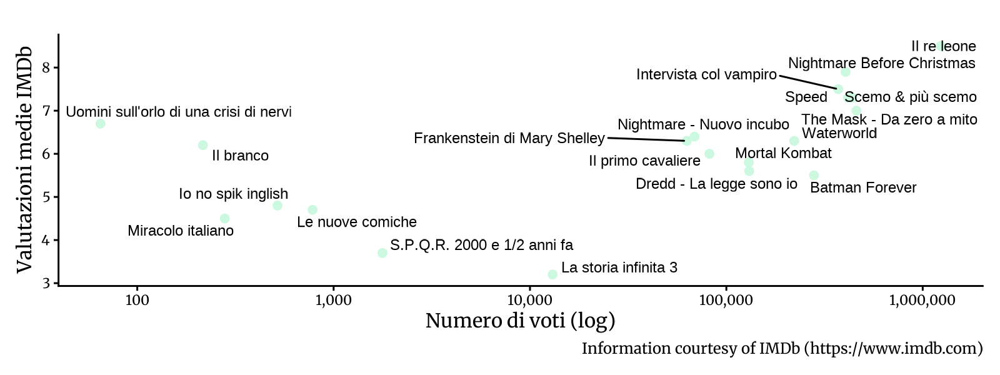

<!-- Generato da R/update-anni.R; modificare i dati, non questa pagina. -->

I grafici riassumono le voci di programmazione associate alle date nel database, non il numero delle singole proiezioni. In alcuni casi la data assegnata puo' essere adiacente a quella riportata nella fonte; per verificarla, consulta la scansione e la [metodologia](/2026/11/11/metodologia-ricostruzione-programmazione/).

I voti IMDb descrivono le valutazioni degli utenti IMDb, non il pubblico o gli incassi del Cinema Sestito.

### Gennaio[^1]

|           |                                       |
|:----------|:--------------------------------------|
| 1995-01-08 | [Le nuove comiche](https://www.imdb.com/title/tt0159611/) |
| 1995-01-21 | [Il re leone](https://www.imdb.com/title/tt0110357/) |

### Febbraio

|           |                                       |
|:----------|:--------------------------------------|
| 1995-02-04 | [S.P.Q.R. 2000 e 1/2 anni fa](https://www.imdb.com/title/tt0111049/) |
| 1995-02-12 | [Il branco](https://www.imdb.com/title/tt0110761/) |
| 1995-02-19 | [Intervista col vampiro](https://www.imdb.com/title/tt0110148/) |
| 1995-02-25 | [Nightmare Before Christmas](https://www.imdb.com/title/tt0107688/) |

### Marzo

|           |                                       |
|:----------|:--------------------------------------|
| 1995-03-26 | [The Mask - Da zero a mito](https://www.imdb.com/title/tt0110475/) |

### Aprile

|           |                                       |
|:----------|:--------------------------------------|
| 1995-04-09 | [Speed](https://www.imdb.com/title/tt0111257/) |
| 1995-04-16 | [Miracolo italiano](https://www.imdb.com/title/tt0110528/) |
| 1995-04-23 | [Uomini sull'orlo di una crisi di nervi](https://www.imdb.com/title/tt0114806/) |

### Giugno

|           |                                       |
|:----------|:--------------------------------------|
| 1995-06-04 | [Nightmare - Nuovo incubo](https://www.imdb.com/title/tt0111686/) |

### Ottobre

|           |                                       |
|:----------|:--------------------------------------|
| 1995-10-15 | [Scemo &amp; più scemo](https://www.imdb.com/title/tt0109686/) |
| 1995-10-22 | [La storia infinita 3](https://www.imdb.com/title/tt0110647/) |
| 1995-10-29 | [Frankenstein di Mary Shelley](https://www.imdb.com/title/tt0109836/) |

### Novembre

|           |                                       |
|:----------|:--------------------------------------|
| 1995-11-05 | [Dredd - La legge sono io](https://www.imdb.com/title/tt0113492/) |
| 1995-11-12 | [Batman Forever](https://www.imdb.com/title/tt0112462/) |
| 1995-11-19 | [Il primo cavaliere](https://www.imdb.com/title/tt0113071/) |

### Dicembre

|           |                                       |
|:----------|:--------------------------------------|
| 1995-12-08 | [Io no spik inglish](https://www.imdb.com/title/tt0113436/) |
| 1995-12-20 | [Waterworld](https://www.imdb.com/title/tt0114898/) |
| 1995-12-26 | [Mortal Kombat](https://www.imdb.com/title/tt0113855/) |

[^1]: Fonti: [Calendario 1995](), [New Europe 1994-95](), [New Europe 1995-00]()

