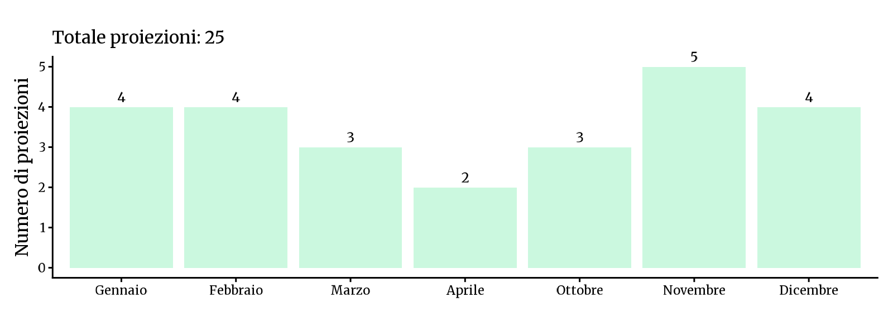
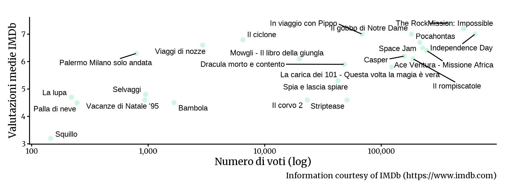

<!-- Generato da R/update-anni.R; modificare i dati, non questa pagina. -->

I grafici riassumono le voci di programmazione associate alle date nel database, non il numero delle singole proiezioni. In alcuni casi la data assegnata puo' essere adiacente a quella riportata nella fonte; per verificarla, consulta la scansione e la [metodologia](/2026/11/11/metodologia-ricostruzione-programmazione/).

I voti IMDb descrivono le valutazioni degli utenti IMDb, non il pubblico o gli incassi del Cinema Sestito.

### Gennaio[^1]

|           |                                       |
|:----------|:--------------------------------------|
| 1996-01-16 | [Pocahontas](https://www.imdb.com/title/tt0114148/) |
| 1996-01-17 | [Vacanze di Natale '95](https://www.imdb.com/title/tt0114820/) |
| 1996-01-21 | [Viaggi di nozze](https://www.imdb.com/title/tt0114844/) |
| 1996-01-28 | [Ace Ventura - Missione Africa](https://www.imdb.com/title/tt0112281/) |

### Febbraio

|           |                                       |
|:----------|:--------------------------------------|
| 1996-02-04 | [Palla di neve](https://www.imdb.com/title/tt0114079/) |
| 1996-02-09 | [Il ciclone](https://www.imdb.com/title/tt0115899/) |
| 1996-02-11 | [Selvaggi](https://www.imdb.com/title/tt0114386/) |
| 1996-02-18 | [Casper](https://www.imdb.com/title/tt0112642/) |

### Marzo

|           |                                       |
|:----------|:--------------------------------------|
| 1996-03-10 | [Palermo Milano solo andata](https://www.imdb.com/title/tt0114078/) |
| 1996-03-30 | [Space Jam](https://www.imdb.com/title/tt0117705/) |
| 1996-03-31 | [Dracula morto e contento](https://www.imdb.com/title/tt0112896/) |

### Aprile

|           |                                       |
|:----------|:--------------------------------------|
| 1996-04-13 | [La carica dei 101 - Questa volta la magia è vera](https://www.imdb.com/title/tt0115433/) |
| 1996-04-21 | [Mowgli - Il libro della giungla](https://www.imdb.com/title/tt0110213/) |

### Ottobre

|           |                                       |
|:----------|:--------------------------------------|
| 1996-10-13 | [Striptease](https://www.imdb.com/title/tt0117765/) |
| 1996-10-20 | [Bambola](https://www.imdb.com/title/tt0115794/) |
| 1996-10-27 | [Il rompiscatole](https://www.imdb.com/title/tt0115798/) |

### Novembre

|           |                                       |
|:----------|:--------------------------------------|
| 1996-11-03 | [The Rock](https://www.imdb.com/title/tt0117500/) |
| 1996-11-10 | [In viaggio con Pippo](https://www.imdb.com/title/tt0113198/) |
| 1996-11-17 | [La lupa](https://www.imdb.com/title/tt0116942/) |
| 1996-11-21 | [Independence Day](https://www.imdb.com/title/tt0116629/) |
| 1996-11-28 | [Squillo](https://www.imdb.com/title/tt0117725/) |

### Dicembre

|           |                                       |
|:----------|:--------------------------------------|
| 1996-12-08 | [Mission: Impossible](https://www.imdb.com/title/tt0117060/) |
| 1996-12-15 | [Il corvo 2](https://www.imdb.com/title/tt0115986/) |
| 1996-12-22 | [Spia e lascia spiare](https://www.imdb.com/title/tt0117723/) |
| 1996-12-29 | [Il gobbo di Notre Dame](https://www.imdb.com/title/tt0116583/) |

[^1]: Fonti: [Calendario 1996](), [Calendario 1997](), [New Europe 1995-00]()

