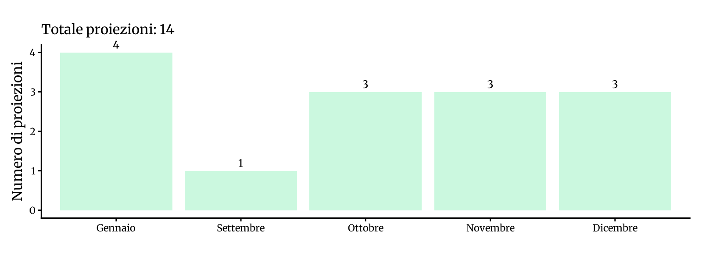
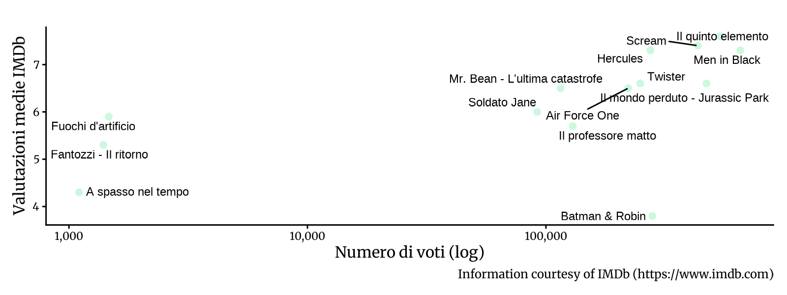

<!-- Generato da R/update-anni.R; modificare i dati, non questa pagina. -->

I grafici riassumono le voci di programmazione associate alle date nel database, non il numero delle singole proiezioni. In alcuni casi la data assegnata puo' essere adiacente a quella riportata nella fonte; per verificarla, consulta la scansione e la [metodologia](/2026/11/11/metodologia-ricostruzione-programmazione/).

I voti IMDb descrivono le valutazioni degli utenti IMDb, non il pubblico o gli incassi del Cinema Sestito.

### Gennaio[^1]

|           |                                       |
|:----------|:--------------------------------------|
| 1997-01-05 | [Il professore matto](https://www.imdb.com/title/tt0117218/) |
| 1997-01-12 | [A spasso nel tempo](https://www.imdb.com/title/tt0115446/) |
| 1997-01-19 | [Fantozzi - Il ritorno](https://www.imdb.com/title/tt0116279/) |
| 1997-01-26 | [Twister](https://www.imdb.com/title/tt0117998/) |

### Settembre

|           |                                       |
|:----------|:--------------------------------------|
| 1997-09-28 | [Batman &amp; Robin](https://www.imdb.com/title/tt0118688/) |

### Ottobre

|           |                                       |
|:----------|:--------------------------------------|
| 1997-10-05 | [Il mondo perduto - Jurassic Park](https://www.imdb.com/title/tt0119567/) |
| 1997-10-19 | [Scream](https://www.imdb.com/title/tt0117571/) |
| 1997-10-26 | [Air Force One](https://www.imdb.com/title/tt0118571/) |

### Novembre

|           |                                       |
|:----------|:--------------------------------------|
| 1997-11-02 | [Soldato Jane](https://www.imdb.com/title/tt0119173/) |
| 1997-11-09 | [Men in Black](https://www.imdb.com/title/tt0119654/) |
| 1997-11-16 | [Fuochi d'artificio](https://www.imdb.com/title/tt0119169/) |

### Dicembre

|           |                                       |
|:----------|:--------------------------------------|
| 1997-12-14 | [Il quinto elemento](https://www.imdb.com/title/tt0119116/) |
| 1997-12-21 | [Mr. Bean - L'ultima catastrofe](https://www.imdb.com/title/tt0118689/) |
| 1997-12-28 | [Hercules](https://www.imdb.com/title/tt0119282/) |

[^1]: Fonti: [Calendario 1997](), [New Europe 1995-00]()

