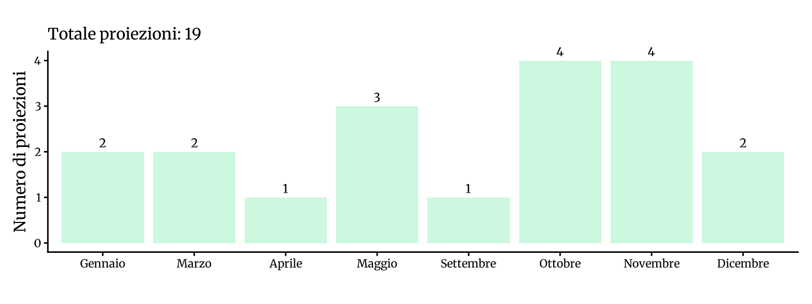
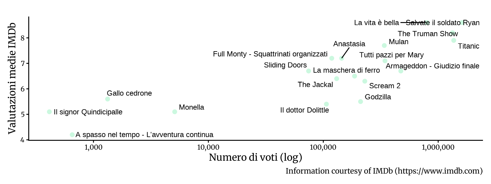

<!-- Generato da R/update-anni.R; modificare i dati, non questa pagina. -->

I grafici riassumono le voci di programmazione associate alle date nel database, non il numero delle singole proiezioni. In alcuni casi la data assegnata puo' essere adiacente a quella riportata nella fonte; per verificarla, consulta la scansione e la [metodologia](/2026/11/11/metodologia-ricostruzione-programmazione/).

I voti IMDb descrivono le valutazioni degli utenti IMDb, non il pubblico o gli incassi del Cinema Sestito.

### Gennaio[^1]

|           |                                       |
|:----------|:--------------------------------------|
| 1998-01-04 | [A spasso nel tempo - L'avventura continua](https://www.imdb.com/title/tt0155463/) |
| 1998-01-25 | [La vita è bella](https://www.imdb.com/title/tt0118799/) |

### Marzo

|           |                                       |
|:----------|:--------------------------------------|
| 1998-03-08 | [Monella](https://www.imdb.com/title/tt0174931/) |
| 1998-03-15 | [Titanic](https://www.imdb.com/title/tt0120338/) |

### Aprile

|           |                                       |
|:----------|:--------------------------------------|
| 1998-04-05 | [The Jackal](https://www.imdb.com/title/tt0119395/) |

### Maggio

|           |                                       |
|:----------|:--------------------------------------|
| 1998-05-03 | [La maschera di ferro](https://www.imdb.com/title/tt0120744/) |
| 1998-05-17 | [Anastasia](https://www.imdb.com/title/tt0118617/) |
| 1998-05-24 | [Full Monty - Squattrinati organizzati](https://www.imdb.com/title/tt0119164/) |

### Settembre

|           |                                       |
|:----------|:--------------------------------------|
| 1998-09-27 | [Armageddon - Giudizio finale](https://www.imdb.com/title/tt0120591/) |

### Ottobre

|           |                                       |
|:----------|:--------------------------------------|
| 1998-10-04 | [Godzilla](https://www.imdb.com/title/tt0120685/) |
| 1998-10-11 | [Il dottor Dolittle](https://www.imdb.com/title/tt0118998/) |
| 1998-10-18 | [Scream 2](https://www.imdb.com/title/tt0120082/) |
| 1998-10-25 | [Sliding Doors](https://www.imdb.com/title/tt0120148/) |

### Novembre

|           |                                       |
|:----------|:--------------------------------------|
| 1998-11-01 | [Il signor Quindicipalle](https://www.imdb.com/title/tt0140547/) |
| 1998-11-08 | [Gallo cedrone](https://www.imdb.com/title/tt0167947/) |
| 1998-11-15 | [The Truman Show](https://www.imdb.com/title/tt0120382/) |
| 1998-11-29 | [Tutti pazzi per Mary](https://www.imdb.com/title/tt0129387/) |

### Dicembre

|           |                                       |
|:----------|:--------------------------------------|
| 1998-12-06 | [Salvate il soldato Ryan](https://www.imdb.com/title/tt0120815/) |
| 1998-12-27 | [Mulan](https://www.imdb.com/title/tt0120762/) |

[^1]: Fonti: [Calendario 1998](), [New Europe 1995-00]()

