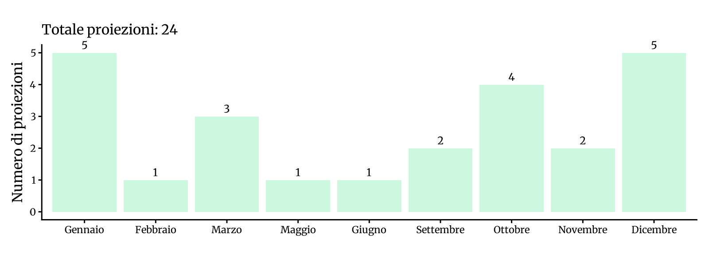
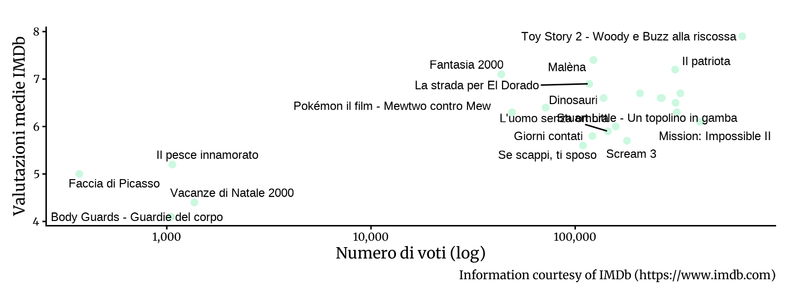

<!-- Generato da R/update-anni.R; modificare i dati, non questa pagina. -->

I grafici riassumono le voci di programmazione associate alle date nel database, non il numero delle singole proiezioni. In alcuni casi la data assegnata puo' essere adiacente a quella riportata nella fonte; per verificarla, consulta la scansione e la [metodologia](/2026/11/11/metodologia-ricostruzione-programmazione/).

I voti IMDb descrivono le valutazioni degli utenti IMDb, non il pubblico o gli incassi del Cinema Sestito.

### Gennaio[^1]

|           |                                       |
|:----------|:--------------------------------------|
| 2000-01-02 | [Vacanze di Natale 2000](https://www.imdb.com/title/tt0200245/) |
| 2000-01-09 | [Se scappi, ti sposo](https://www.imdb.com/title/tt0163187/) |
| 2000-01-16 | [Il pesce innamorato](https://www.imdb.com/title/tt0210225/) |
| 2000-01-23 | [Giorni contati](https://www.imdb.com/title/tt0146675/) |
| 2000-01-30 | [Il 13º guerriero](https://www.imdb.com/title/tt0120657/) |

### Febbraio

|           |                                       |
|:----------|:--------------------------------------|
| 2000-02-27 | [La nona porta](https://www.imdb.com/title/tt0142688/) |

### Marzo

|           |                                       |
|:----------|:--------------------------------------|
| 2000-03-12 | [The Blair Witch Project - Il mistero della strega di Blair](https://www.imdb.com/title/tt0185937/) |
| 2000-03-19 | [Toy Story 2 - Woody e Buzz alla riscossa](https://www.imdb.com/title/tt0120363/) |
| 2000-03-26 | [The Beach](https://www.imdb.com/title/tt0163978/) |

### Maggio

|           |                                       |
|:----------|:--------------------------------------|
| 2000-05-20 | [Pokémon il film - Mewtwo contro Mew](https://www.imdb.com/title/tt0190641/) |

### Giugno

|           |                                       |
|:----------|:--------------------------------------|
| 2000-06-04 | [Stuart Little - Un topolino in gamba](https://www.imdb.com/title/tt0164912/) |

### Settembre

|           |                                       |
|:----------|:--------------------------------------|
| 2000-09-17 | [Mission: Impossible II](https://www.imdb.com/title/tt0120755/) |
| 2000-09-24 | [Il patriota](https://www.imdb.com/title/tt0187393/) |

### Ottobre

|           |                                       |
|:----------|:--------------------------------------|
| 2000-10-01 | [Scream 3](https://www.imdb.com/title/tt0134084/) |
| 2000-10-08 | [Io, me &amp; Irene](https://www.imdb.com/title/tt0183505/) |
| 2000-10-15 | [Fantasia 2000](https://www.imdb.com/title/tt0120910/) |
| 2000-10-22 | [Final Destination](https://www.imdb.com/title/tt0195714/) |

### Novembre

|           |                                       |
|:----------|:--------------------------------------|
| 2000-11-19 | [Faccia di Picasso](https://www.imdb.com/title/tt0256015/) |
| 2000-11-26 | [L'uomo senza ombra](https://www.imdb.com/title/tt0164052/) |

### Dicembre

|           |                                       |
|:----------|:--------------------------------------|
| 2000-12-03 | [Malèna](https://www.imdb.com/title/tt0213847/) |
| 2000-12-08 | [La strada per El Dorado](https://www.imdb.com/title/tt0138749/) |
| 2000-12-10 | [Scary Movie - Senza paura, senza vergogna... senza cervello!](https://www.imdb.com/title/tt0175142/) |
| 2000-12-24 | [Dinosauri](https://www.imdb.com/title/tt0130623/) |
| 2000-12-26 | [Body Guards - Guardie del corpo](https://www.imdb.com/title/tt0269009/) |

[^1]: Fonti: [Calendario 2000](), [New Europe 1995-00](), [Victory 2000]()

