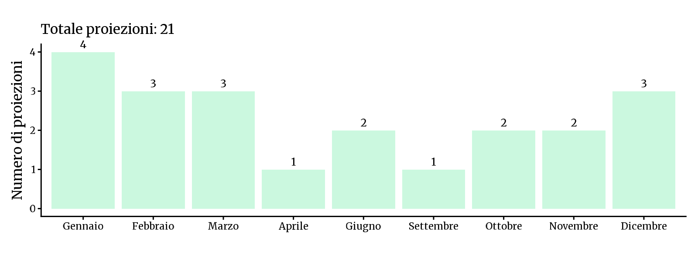
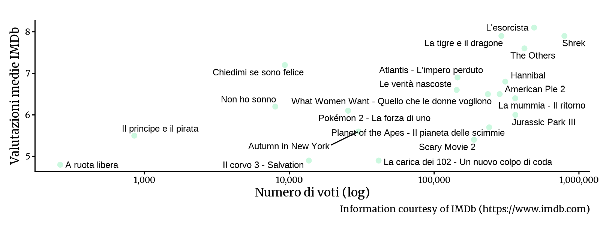

<!-- Generato da R/update-anni.R; modificare i dati, non questa pagina. -->

I grafici riassumono le voci di programmazione associate alle date nel database, non il numero delle singole proiezioni. In alcuni casi la data assegnata puo' essere adiacente a quella riportata nella fonte; per verificarla, consulta la scansione e la [metodologia](/2026/11/11/metodologia-ricostruzione-programmazione/).

I voti IMDb descrivono le valutazioni degli utenti IMDb, non il pubblico o gli incassi del Cinema Sestito.

### Gennaio[^1]

|           |                                       |
|:----------|:--------------------------------------|
| 2001-01-06 | [L'esorcista](https://www.imdb.com/title/tt0070047/) |
| 2001-01-07 | [Chiedimi se sono felice](https://www.imdb.com/title/tt0252985/) |
| 2001-01-21 | [A ruota libera](https://www.imdb.com/title/tt0268879/) |
| 2001-01-28 | [Autumn in New York](https://www.imdb.com/title/tt0174480/) |

### Febbraio

|           |                                       |
|:----------|:--------------------------------------|
| 2001-02-04 | [La carica dei 102 - Un nuovo colpo di coda](https://www.imdb.com/title/tt0211181/) |
| 2001-02-11 | [Le verità nascoste](https://www.imdb.com/title/tt0161081/) |
| 2001-02-18 | [Pokémon 2 - La forza di uno](https://www.imdb.com/title/tt0210234/) |

### Marzo

|           |                                       |
|:----------|:--------------------------------------|
| 2001-03-04 | [Non ho sonno](https://www.imdb.com/title/tt0220827/) |
| 2001-03-11 | [Hannibal](https://www.imdb.com/title/tt0212985/) |
| 2001-03-18 | [What Women Want - Quello che le donne vogliono](https://www.imdb.com/title/tt0207201/) |

### Aprile

|           |                                       |
|:----------|:--------------------------------------|
| 2001-04-22 | [La tigre e il dragone](https://www.imdb.com/title/tt0190332/) |

### Giugno

|           |                                       |
|:----------|:--------------------------------------|
| 2001-06-10 | [La mummia - Il ritorno](https://www.imdb.com/title/tt0209163/) |
| 2001-06-17 | [Il corvo 3 - Salvation](https://www.imdb.com/title/tt0132910/) |

### Settembre

|           |                                       |
|:----------|:--------------------------------------|
| 2001-09-30 | [Jurassic Park III](https://www.imdb.com/title/tt0163025/) |

### Ottobre

|           |                                       |
|:----------|:--------------------------------------|
| 2001-10-14 | [Planet of the Apes - Il pianeta delle scimmie](https://www.imdb.com/title/tt0133152/) |
| 2001-10-21 | [Shrek](https://www.imdb.com/title/tt0126029/) |

### Novembre

|           |                                       |
|:----------|:--------------------------------------|
| 2001-11-04 | [Scary Movie 2](https://www.imdb.com/title/tt0257106/) |
| 2001-11-11 | [The Others](https://www.imdb.com/title/tt0230600/) |

### Dicembre

|           |                                       |
|:----------|:--------------------------------------|
| 2001-12-02 | [American Pie 2](https://www.imdb.com/title/tt0252866/) |
| 2001-12-23 | [Atlantis - L'impero perduto](https://www.imdb.com/title/tt0230011/) |
| 2001-12-26 | [Il principe e il pirata](https://www.imdb.com/title/tt0305981/) |

[^1]: Fonti: [Calendario 2001](), [Victory 2000]()

