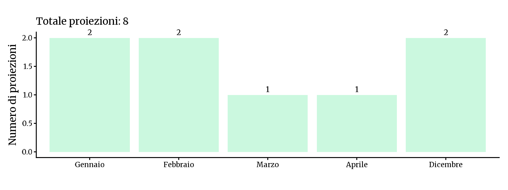
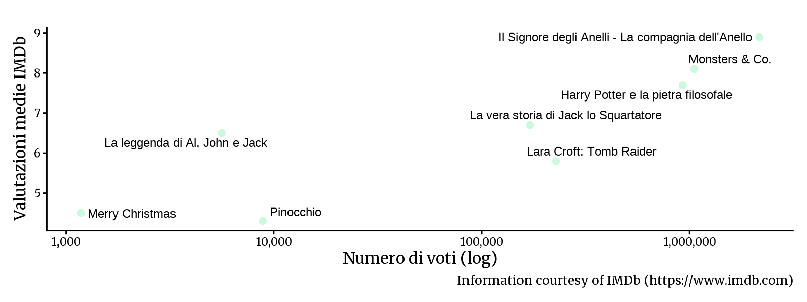

<!-- Generato da R/update-anni.R; modificare i dati, non questa pagina. -->

I grafici riassumono le voci di programmazione associate alle date nel database, non il numero delle singole proiezioni. In alcuni casi la data assegnata puo' essere adiacente a quella riportata nella fonte; per verificarla, consulta la scansione e la [metodologia](/2026/11/11/metodologia-ricostruzione-programmazione/).

I voti IMDb descrivono le valutazioni degli utenti IMDb, non il pubblico o gli incassi del Cinema Sestito.

### Gennaio[^1]

|           |                                       |
|:----------|:--------------------------------------|
| 2002-01-06 | [Merry Christmas](https://www.imdb.com/title/tt0295473/) |
| 2002-01-13 | [Harry Potter e la pietra filosofale](https://www.imdb.com/title/tt0241527/) |

### Febbraio

|           |                                       |
|:----------|:--------------------------------------|
| 2002-02-03 | [Lara Croft: Tomb Raider](https://www.imdb.com/title/tt0146316/) |
| 2002-02-10 | [Il Signore degli Anelli - La compagnia dell'Anello](https://www.imdb.com/title/tt0120737/) |

### Marzo

|           |                                       |
|:----------|:--------------------------------------|
| 2002-03-03 | [La vera storia di Jack lo Squartatore](https://www.imdb.com/title/tt0120681/) |

### Aprile

|           |                                       |
|:----------|:--------------------------------------|
| 2002-04-28 | [Monsters &amp; Co.](https://www.imdb.com/title/tt0198781/) |

### Dicembre

|           |                                       |
|:----------|:--------------------------------------|
| 2002-12-15 | [Pinocchio](https://www.imdb.com/title/tt0255477/) |
| 2002-12-26 | [La leggenda di Al, John e Jack](https://www.imdb.com/title/tt0345561/) |

[^1]: Fonti: [Calendario 2002](), [Victory 2000]()

