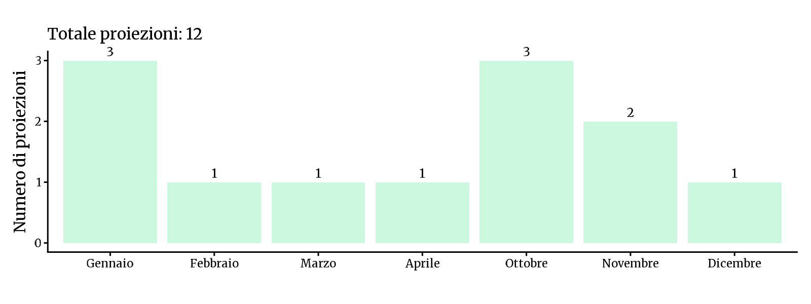
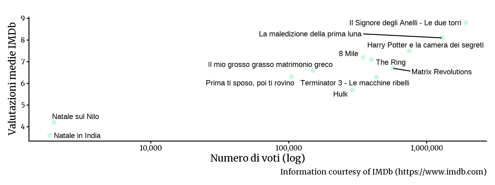

<!-- Generato da R/update-anni.R; modificare i dati, non questa pagina. -->

I grafici riassumono le voci di programmazione associate alle date nel database, non il numero delle singole proiezioni. In alcuni casi la data assegnata puo' essere adiacente a quella riportata nella fonte; per verificarla, consulta la scansione e la [metodologia](/2026/11/11/metodologia-ricostruzione-programmazione/).

I voti IMDb descrivono le valutazioni degli utenti IMDb, non il pubblico o gli incassi del Cinema Sestito.

### Gennaio[^1]

|           |                                       |
|:----------|:--------------------------------------|
| 2003-01-12 | [Natale sul Nilo](https://www.imdb.com/title/tt0337689/) |
| 2003-01-19 | [Harry Potter e la camera dei segreti](https://www.imdb.com/title/tt0295297/) |
| 2003-01-26 | [Il Signore degli Anelli - Le due torri](https://www.imdb.com/title/tt0167261/) |

### Febbraio

|           |                                       |
|:----------|:--------------------------------------|
| 2003-02-09 | [Il mio grosso grasso matrimonio greco](https://www.imdb.com/title/tt0259446/) |

### Marzo

|           |                                       |
|:----------|:--------------------------------------|
| 2003-03-30 | [The Ring](https://www.imdb.com/title/tt0298130/) |

### Aprile

|           |                                       |
|:----------|:--------------------------------------|
| 2003-04-06 | [8 Mile](https://www.imdb.com/title/tt0298203/) |

### Ottobre

|           |                                       |
|:----------|:--------------------------------------|
| 2003-10-05 | [Hulk](https://www.imdb.com/title/tt0286716/) |
| 2003-10-07 | [La maledizione della prima luna](https://www.imdb.com/title/tt0325980/) |
| 2003-10-12 | [Terminator 3 - Le macchine ribelli](https://www.imdb.com/title/tt0181852/) |

### Novembre

|           |                                       |
|:----------|:--------------------------------------|
| 2003-11-16 | [Prima ti sposo, poi ti rovino](https://www.imdb.com/title/tt0138524/) |
| 2003-11-23 | [Matrix Revolutions](https://www.imdb.com/title/tt0242653/) |

### Dicembre

|           |                                       |
|:----------|:--------------------------------------|
| 2003-12-28 | [Natale in India](https://www.imdb.com/title/tt0392494/) |

[^1]: Fonti: [Calendario 2003](), [Victory 2000]()

