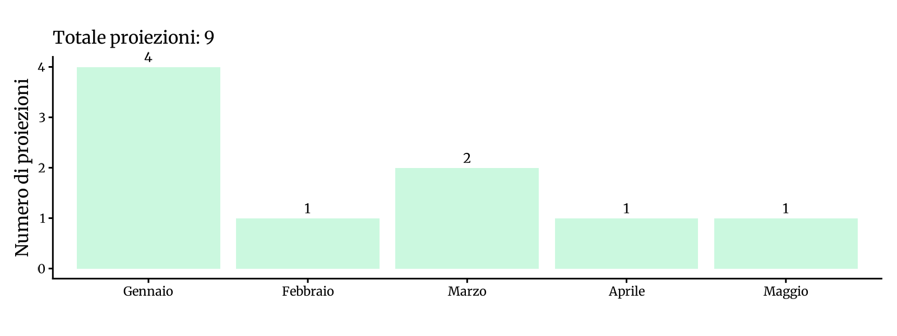
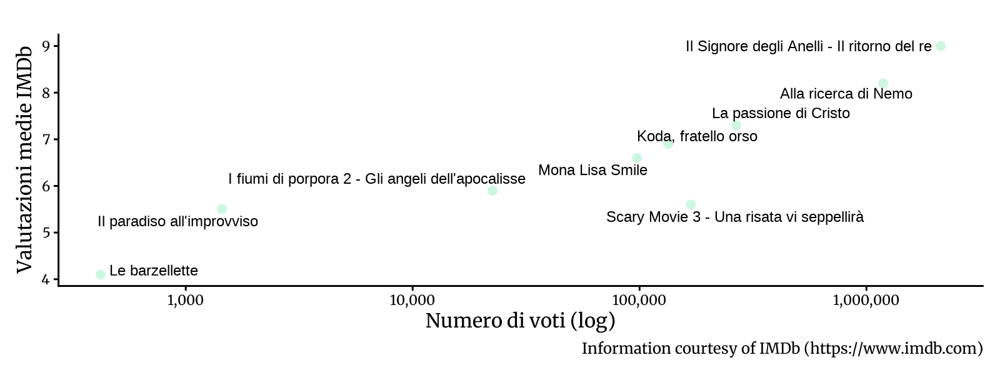

<!-- Generato da R/update-anni.R; modificare i dati, non questa pagina. -->

I grafici riassumono le voci di programmazione associate alle date nel database, non il numero delle singole proiezioni. In alcuni casi la data assegnata puo' essere adiacente a quella riportata nella fonte; per verificarla, consulta la scansione e la [metodologia](/2026/11/11/metodologia-ricostruzione-programmazione/).

I voti IMDb descrivono le valutazioni degli utenti IMDb, non il pubblico o gli incassi del Cinema Sestito.

### Gennaio[^1]

|           |                                       |
|:----------|:--------------------------------------|
| 2004-01-01 | [Alla ricerca di Nemo](https://www.imdb.com/title/tt0266543/) |
| 2004-01-11 | [Il paradiso all'improvviso](https://www.imdb.com/title/tt0392591/) |
| 2004-01-18 | [Mona Lisa Smile](https://www.imdb.com/title/tt0304415/) |
| 2004-01-25 | [Il Signore degli Anelli - Il ritorno del re](https://www.imdb.com/title/tt0167260/) |

### Febbraio

|           |                                       |
|:----------|:--------------------------------------|
| 2004-02-15 | [Le barzellette](https://www.imdb.com/title/tt0402832/) |

### Marzo

|           |                                       |
|:----------|:--------------------------------------|
| 2004-03-07 | [Scary Movie 3 - Una risata vi seppellirà](https://www.imdb.com/title/tt0306047/) |
| 2004-03-30 | [Koda, fratello orso](https://www.imdb.com/title/tt0328880/) |

### Aprile

|           |                                       |
|:----------|:--------------------------------------|
| 2004-04-18 | [I fiumi di porpora 2 - Gli angeli dell'apocalisse](https://www.imdb.com/title/tt0337103/) |

### Maggio

|           |                                       |
|:----------|:--------------------------------------|
| 2004-05-02 | [La passione di Cristo](https://www.imdb.com/title/tt0335345/) |

[^1]: Fonti: [Calendario 2004](), [Victory 2000]()

